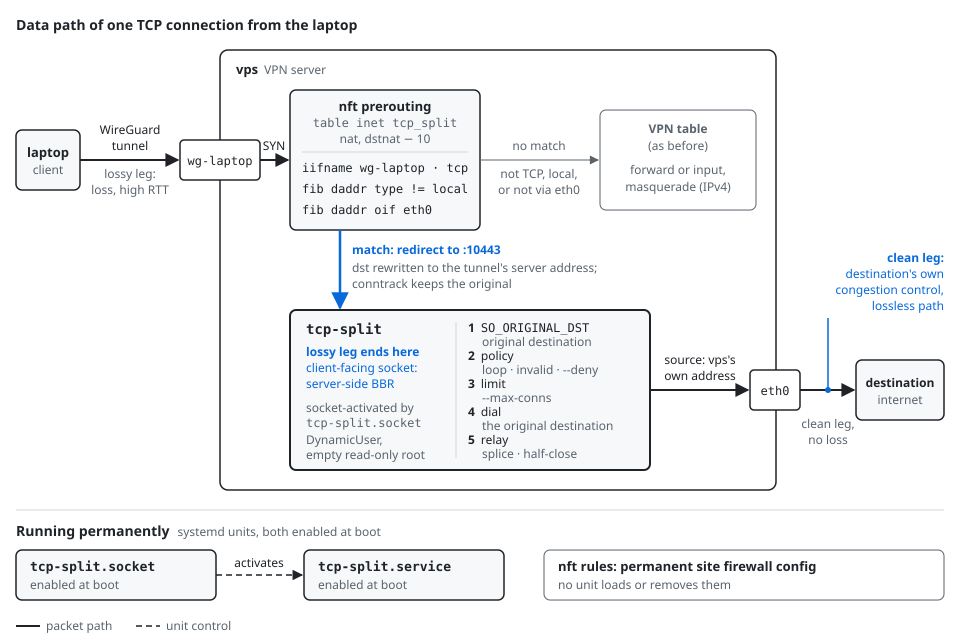

# tcp-split

`tcp-split` is a split-TCP proxy for lossy VPN clients. A laptop reaches its home network and a remote VPN server through WireGuard tunnels; over a long, lossy path the tunnel legs can see double-digit packet loss and several hundred milliseconds of round-trip time, and a forwarded TCP connection runs the far server's congestion control over that whole lossy path. `tcp-split` makes every forwarded TCP connection terminate on the VPN server (which runs BBR): the server intercepts the connection, opens its own connection to the real destination, and relays bytes both ways, so the lossy leg is always a server-side BBR socket and the clean leg runs over a path with no loss. It is a performance-enhancing proxy, not a privacy, circumvention or security feature.

## How it works



A forwarded TCP connection from the laptop is terminated on the VPN server and re-originated from it, so the lossy tunnel leg runs on a server-side BBR socket while the clean leg runs the destination's own congestion control; and if the proxy is not running, the interception rules are gone and the kernel forwards as before.

Reading left to right: traffic from the laptop arrives on `vps` through the WireGuard tunnel on `wg-laptop`, and the `prerouting` rule redirects a connection to the proxy's port only if it is TCP, its destination is not local, and the kernel would route that destination out of `eth0`; everything else is handled by the VPN table as before (forward or input chain, masquerade). `tcp-split` recovers the original destination with `SO_ORIGINAL_DST`, checks it against its policy and connection limit, dials it from `vps`'s own address and relays bytes both ways. Below, `tcp-split.socket` `Wants=` the redirect unit, which loads the `inet tcp_split` table, and the redirect unit is `BindsTo=` the socket, so stopping the socket deletes the table and interception stops with it.

## Install

From the signed apt repository at <https://mith.ro/go-tcp-split/>, on Debian
or Raspberry Pi OS. There is one per suite: `trixie`, `forky` and `sid`, and
`raspbian-trixie` and `raspbian-forky` for 32-bit Raspberry Pi OS (ARMv6). Put
your suite's name in place of `trixie` below:

```sh
sudo install -d -m0755 /etc/apt/keyrings
curl -fsSL https://mith.ro/go-tcp-split/go-tcp-split.gpg | sudo tee /etc/apt/keyrings/go-tcp-split.gpg > /dev/null
echo "deb [signed-by=/etc/apt/keyrings/go-tcp-split.gpg] https://mith.ro/go-tcp-split/trixie/ ./" \
  | sudo tee /etc/apt/sources.list.d/go-tcp-split.list
sudo apt update
sudo apt install tcp-split
```

The repository's signing key is
`45D2 E2D9 4305 121B 96BF  171B A767 675E B2EF 21AF`
(`gpg --show-keys /etc/apt/keyrings/go-tcp-split.gpg` shows it).

## Status

First release in progress: packages publish to https://mith.ro/go-tcp-split/ on merge to main.

## Build

```
CGO_ENABLED=0 go build -trimpath -ldflags "-s -w -X github.com/mithro/go-tcp-split/internal/cli.Version=$(VERSION)" -o dist/tcp-split ./cmd/tcp-split
```

Or `make build` (`VERSION` defaults to `dev`).

## Units

The package ships two systemd units (see `packaging/README.md`) and enables neither. The site enables and starts both, and the proxy then runs permanently from boot:

```sh
sudo systemctl enable --now tcp-split.socket tcp-split.service
```

`tcp-split.socket` owns the listening sockets. The site adds a drop-in with one `ListenStream=` per tunnel server address (both families); it never listens on a wildcard. `FreeBind=yes` lets it bind the tunnel addresses before the tunnels exist, and because it passes the listeners to the daemon, the service's sandbox keeps `SocketBindDeny=any`.

`tcp-split.service` is the sandboxed daemon. It `Requires=` the socket and is `WantedBy=multi-user.target`, so it starts at boot rather than on a first connection. Its flags come from `TCP_SPLIT_OPTS` in `/etc/default/tcp-split`.

The interception rules are not managed by either unit. They are the site's permanent firewall configuration: copy `packaging/examples/redirect.nft` (installed as `/usr/share/doc/tcp-split/examples/redirect.nft`) into the site's persistent nftables configuration, for example included from `/etc/nftables.conf` or the VPN firewall's own file. It is a table of its own, `inet tcp_split`.

There is no fail-open. While the proxy is down (the socket unit stopped, or the service failed past its restart limit), the rules still redirect tunnel TCP to its port and those connections are reset; they work again once `tcp-split.socket` and `tcp-split.service` are running. To stop splitting on purpose, remove the table from the site's configuration.

## Firewall: split traffic bypasses the forward chain

Split connections originate from the host itself. After the redirect, the onward connection to the destination is opened by the `tcp-split` process, so it leaves through the host's `output` path and never traverses the VPN table's `forward` chain. Any per-destination, per-port or per-peer restriction that the `forward` chain applies to tunnel traffic (for example `tcp dport 25 drop`, or a peer limited to some destinations) is therefore bypassed for every split connection. `tcp-split` can reach every destination routed out of `WAN_IF` except the `--deny` prefixes. Such restrictions must instead be expressed in the redirect rule's match in `redirect.nft` (`fib daddr oif $WAN_IF`, plus the `input` guard; traffic the redirect does not match is forwarded and still meets the `forward` chain) and in `--deny`, never only in the `forward` chain. Check the VPN's `forward` chain against this before deploying.

## Usage

```
tcp-split [flags]
```

The daemon takes its listening sockets from systemd socket activation; `--listen` is for running it by hand.

| Flag | Default | Meaning |
|---|---|---|
| `--listen` | none | address to listen on (repeatable) |
| `--deny` | none | CIDR destination to refuse (repeatable) |
| `--connect-timeout` | `10s` | upstream connect timeout |
| `--keepalive` | `60s` | TCP keepalive period |
| `--idle-timeout` | `0` | close connections idle this long (0 disables; otherwise at least `1ms`) |
| `--max-conns` | `4096` | maximum concurrent connections (0 means unlimited) |
| `--congestion` | `""` | TCP congestion control algorithm (empty keeps the system default) |
| `--stats-interval` | `5m` | interval between stats log lines (0 disables) |
| `--drain` | `30s` | graceful shutdown drain time |
| `--verbose` | off | verbose logging |
| `--version` | | print version and exit |

Every value needs its own flag (`--deny A --deny B`, not `--deny A B`): a stray positional argument, a negative duration or a negative `--max-conns` is an error and the daemon exits 2 with a message rather than silently ignoring the rest of the command line.

Each connection logs one `msg=connection` line with `client=`, `dst=` (the original destination; empty when none was recovered), `up=`/`down=` (bytes client to destination and back), `dur=` and a `result=` field, one of:

- `ok`: relayed and closed normally.
- `connect-failed`: the upstream connection could not be made.
- `denied`: the destination matched a `--deny` prefix or is invalid or a loop.
- `not-redirected`: the connection was not an intercepted one (no original destination); it is reset.
- `limit`: refused because `--max-conns` was reached.
- `idle`: closed by `--idle-timeout`.
- `error`: the relay ended on an I/O error or reset.

For `error` and for every refusal (`not-redirected`, `denied`, `connect-failed`, `limit`) the line also carries `err=` with the cause: the original-destination lookup error or `destination is the listener's own address`; the policy reason (`destination denied by policy`, `destination is a proxy listener`, `invalid destination`); the upstream dial error (refused, timed out, unreachable, ...); or `max-conns reached`.

Only `ok` (both directions ended with a normal close) closes the two connections normally. Every other result resets them: a refused connection is reset, and a relay that ends on an error, an idle timeout or a forced drain resets both sides, so neither peer can mistake an aborted transfer for a complete one.
